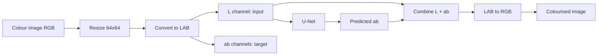

# 🎨 Image Colourisation using Deep Learning (U-Net + LAB)

A deep learning project that converts **grayscale face images into colour images**. A U-Net built in TensorFlow/Keras takes the **L (lightness)** channel of the LAB colour space and predicts the missing **a, b (colour)** channels.

> The model does not recover the *true* colours. It predicts *plausible* colours based on patterns learned from the training data.

---

## 📌 Overview

| Item | Details |
|---|---|
| **Task** | Grayscale → colour image colourisation |
| **Framework** | TensorFlow / Keras |
| **Dataset** | Labeled Faces in the Wild (LFW), loaded with `sklearn.datasets.fetch_lfw_people` |
| **Colour space** | LAB (input: `L`, output: `ab`) |
| **Architecture** | U-Net (encoder–decoder with skip connections) |
| **Loss / Optimiser** | MAE (L1) / Adam (lr = 2e-4) |
| **Image size** | 64 × 64 |
| **Environment** | Google Colab |

---

## 🧠 How it works



**Why LAB?** It separates brightness (`L`) from colour (`a`: green↔red, `b`: blue↔yellow). The grayscale image already gives us `L`, so the network only has to predict two channels: `64×64×1 → 64×64×2`.

---

## 🗂️ Dataset & preprocessing

- **Source:** LAB-converted LFW faces (`color=True`, `min_faces_per_person=10`), about 4,300 images.
- **Resize:** every image to `64 × 64`.
- **Colour conversion:** RGB → LAB using `skimage.color.rgb2lab`.
- **Normalisation:**
  - `L` → `L / 50 − 1`, giving a range of `[-1, 1]`
  - `ab` → `ab / 128`, giving a range of about `[-1, 1]`, which matches the `tanh` output
- **Split:** 85% train / 15% validation (`random_state=42`)

| Split | Input shape | Target shape |
|---|---|---|
| Train | `(3675, 64, 64, 1)` | `(3675, 64, 64, 2)` |

---

## 🏗️ Model architecture (U-Net)

**Encoder** (4 blocks): `Conv2D(k=4, stride=2) → BatchNorm → LeakyReLU(0.2)`, with filters 64 → 128 → 256 → 512. Each block halves the spatial size and extracts richer features (edges → textures → facial structure).

**Bottleneck:** `Conv2D(512, k=3) → ReLU`

**Decoder** (4 blocks): `Conv2DTranspose(k=4, stride=2) → Concatenate(skip) → ReLU`, with filters 512 → 256 → 128 → 64. Skip connections from the encoder (and the input) preserve edges and fine detail, which reduces colour bleeding.

**Output:** `Conv2DTranspose(2, k=4, stride=1, activation='tanh')` gives the predicted `a` and `b` channels.

---

## 🏋️ Training

```python
model.compile(optimizer=Adam(learning_rate=2e-4), loss='mae')
model.fit(X_train, y_train, validation_data=(X_val, y_val),
          epochs=10, batch_size=120)
```

### Results (10 epochs)

| Epoch | Train MAE | Val MAE |
|:---:|:---:|:---:|
| 1 | 0.0756 | 0.0954 |
| 4 | 0.0485 | 0.0532 |
| 7 | 0.0451 | **0.0517** |
| 10 | 0.0408 | 0.0554 |

- Training loss decreases steadily, from **0.0756 to 0.0408**.
- Validation loss is lowest at about **0.0517** (epochs 7 and 9) and then fluctuates, which suggests the model starts to overfit slightly on this small dataset. `EarlyStopping` is already imported and can be used to stop at the best epoch.
- The notebook plots the training vs validation curves and a 3-row comparison: **Grayscale input | Predicted colour | Ground truth**.

---

## 🔍 Inference

1. Upload a portrait photo in Colab.
2. Resize to `64×64` and convert to LAB, then extract and normalise `L`.
3. The model predicts `ab`.
4. Denormalise, combine `L + ab`, convert LAB → RGB.
5. Display the grayscale and colourised images side by side.

---

## 🚀 Getting started

### Run on Google Colab (recommended)
1. Open `Image_Colourisation.ipynb` in [Google Colab](https://colab.research.google.com/).
2. Run all cells. The LFW dataset downloads automatically.
3. When prompted at the end, upload a portrait photo to test.

### Run locally
```bash
git clone https://github.com/ishuu9837/<your-repo-name>.git
cd <your-repo-name>
pip install numpy matplotlib scikit-learn scikit-image tensorflow jupyter
jupyter notebook Image_Colourisation.ipynb
```
> The notebook uses `google.colab.files` for uploads. Locally, replace those calls with a direct image path.

---

## 📁 Project structure

```
.
├── Image_Colourisation.ipynb   # Data prep, U-Net, training, evaluation, inference
└── README.md
```

---

## ⚠️ Limitations

- **Multiple valid colours:** one gray value can map to many colours, so the model can predict the wrong colour for clothes, backgrounds, etc.
- **Desaturated output:** pixel-wise MAE/MSE favours "average" colours, so results can look dull.
- **Small, domain-specific data:** trained only on faces at 64×64, so it generalises poorly to other scenes and gives low-resolution output.
- **Colour bleeding** near object boundaries is possible.

## 🔮 Future improvements

- Train on larger and more diverse datasets (e.g. COCO, ImageNet, Places365)
- Higher resolution (128×128 or 256×256), with colour-only upsampling at inference
- Perceptual loss or a GAN (pix2pix-style) for more vivid colours
- Classification over quantised `ab` bins (Zhang et al.) to avoid averaged colours
- Pretrained encoder (e.g. ResNet / VGG) and data augmentation
- `EarlyStopping` and learning-rate scheduling

---

## 👤 Author

**Y Eswar** · MTech Data Science, GITAM (Deemed to be University)
GitHub: [@ishuu9837](https://github.com/ishuu9837)

---

⭐ If you found this project useful, consider giving it a star!
